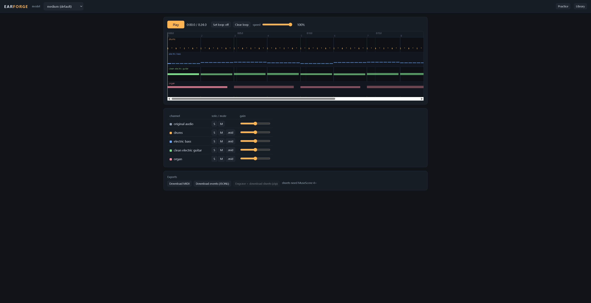
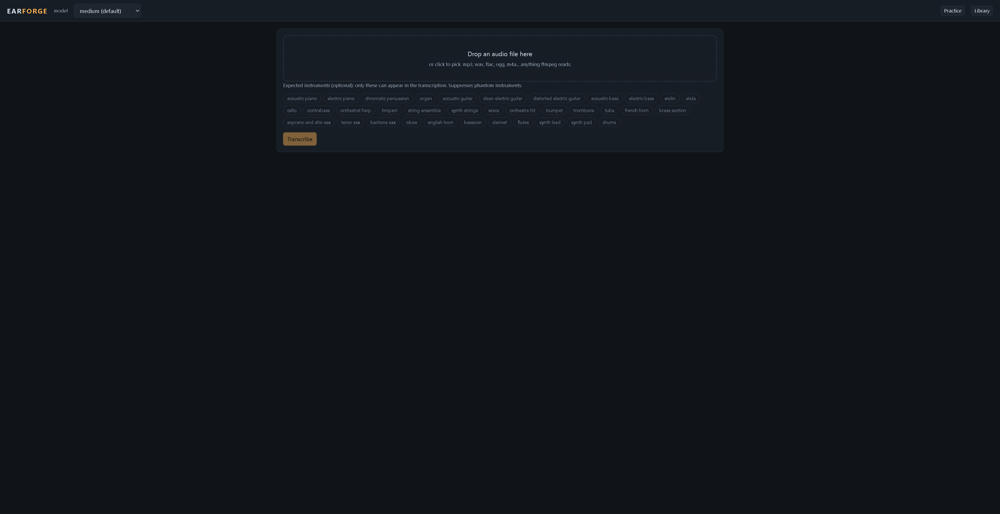

# earforge

A local, GPU-accelerated learn-by-ear workbench. Drop any recording in; earforge turns it into multi-instrument MIDI, a live piano roll, and a play-along practice mixer where every instrument can be soloed, muted, slowed, and looped while you learn the part. It runs [MuScriptor](https://github.com/muscriptor/muscriptor), the open-source music transcription model from Kyutai and Mirelo, on your own machine.



The point is the practice loop, not just the transcription: see the bass lane, solo it, drop the speed to 70%, loop the chorus, and play along. Everything is offline after the one-time model download. Nothing is uploaded anywhere; there is no account and no bill.

## What it does

- `earforge` starts a local server on 127.0.0.1:8417 and opens your browser.
- Drag in any audio file ffmpeg can read (mp3, wav, flac, ogg, m4a, ...). It is converted to 32 kHz mono WAV before the model ever sees it, so container and codec problems cannot reach the model.
- Notes stream into a canvas piano roll live, one colored lane per instrument, with bar lines when a tempo is detected.
- Playback mixes the original audio with per-instrument stems synthesized through fluidsynth (MuseScore_General soundfont). Solo, mute, and a gain slider per instrument, plus a gain slider for the original. Space toggles playback, arrow keys seek (Shift for bigger steps).
- A/B loop by dragging on the ruler. Speed from 50% to 100%, pitch preserved on every source: stems are re-rendered from scaled note times, the original through ffmpeg's atempo time-stretch.
- Exports: the performance MIDI, the raw event stream as JSONL, and the engraved sheets tree (score.mid, score.musicxml, full_score.pdf, one PDF per instrument, tab PDFs for fretted instruments) as a zip.
- Every transcription is kept in a local library (SQLite) with one-click reopen.
- "Expected instruments" chips mask the model's vocabulary, so phantom instruments cannot be decoded at all.

## Install

Python 3.10 to 3.12.

```
pip install earforge
```

Three system programs are optional but each unlocks a feature. earforge tells you in the UI which are missing:

| Program | Needed for | Notes |
|---|---|---|
| [ffmpeg](https://ffmpeg.org/download.html) | decoding audio (required) | must be on PATH |
| [fluidsynth](https://github.com/FluidSynth/fluidsynth/releases) | synthesized instrument stems | without it the roll still plays against the original audio |
| [MuseScore 4+](https://musescore.org/en/download) | the sheets export | the button is hidden with an install hint without it |

### One-time model setup (free)

The MuScriptor weights are gated behind their CC BY-NC 4.0 license. Access is free and granted automatically:

1. Accept the license on the model page, e.g. [muscriptor-medium](https://huggingface.co/MuScriptor/muscriptor-medium).
2. Create a read token at [huggingface.co/settings/tokens](https://huggingface.co/settings/tokens) and set it:

```
setx HF_TOKEN hf_...        # Windows (then reopen the terminal)
export HF_TOKEN=hf_...      # macOS / Linux
```

Weights download on first transcription (medium is about 1.2 GB) and are cached. The soundfont (~215 MB, MIT licensed) also downloads once. After that, unplug the network and everything still works.

### GPU on Windows

PyPI's torch wheels for Windows are CPU-only. For CUDA (substantially faster than CPU for the medium and large models), install the CUDA build after earforge:

```
pip install earforge
pip install torch --force-reinstall --index-url https://download.pytorch.org/whl/cu128
```

On Linux the default torch wheel already includes CUDA; on Apple Silicon the model uses MPS automatically.

## Usage

```
earforge
```

That is the whole interface. Optional flags:

```
earforge --model large        # most accurate, wants a GPU
earforge --model small        # CPU-friendly
earforge --port 8417 --no-browser
earforge library              # list past transcriptions in the terminal
```

In the browser: drop a file, optionally tick the instruments you expect (masking a rock track down to guitars, bass and drums kills phantom harps), and watch the lanes fill in. Then practice: Space plays/pauses, drag on the ruler to loop, click anywhere to seek, S/M per lane to solo or mute.

### A real example

Everything below was produced by driving the shipped package in a real browser on Windows 11 (screenshots in `docs/`). The upload view with the instrument chips:



Without `HF_TOKEN` the first transcription stops at the model download with the exact setup steps, instead of a stack trace:

```
cannot download 'MuScriptor/muscriptor-medium' from HuggingFace: the MuScriptor model
weights are gated and require a (free) HuggingFace account.

  1. Accept the model license at https://huggingface.co/MuScriptor/muscriptor-medium
     (access is granted automatically).
  2. Authenticate on this machine, either:
       - run: uvx hf auth login
       - or set the HF_TOKEN environment variable to a read token
```

With the token set, dropping a 3:20 rock-track MP3 on an RTX 4090 with the default medium model streams progress like `transcribing: chunk 12/40 · eta 34s` and settles within a minute or two on lanes for the instruments the track actually holds (typically distorted_electric_guitar, electric_bass, drums, often more). Clicking S on electric_bass plays only the synthesized bass, in sync with the roll. That acceptance run needs the owner's HF token, so the shipped UI was verified end to end with the labelled example job instead (`python examples/seed_demo_job.py`): 208 notes over 4 lanes reopen from the Library tab through the same SSE replay path a real transcription uses, stems render at both speeds (the mixer's rendering indicators clear), playback advances the playhead, solo/mute/loop/speed all respond, and the exports answer like this:

```
GET /api/jobs/<id>/export/midi
Content-Disposition: attachment; filename="[example] demo score.mid"

library/<id>/stems/
├── 0.75/  (drums, electric_bass, clean_electric_guitar, organ .wav)
└── 1.00/  (drums, electric_bass, clean_electric_guitar, organ .wav)
```

With MuseScore 4 installed, the sheets export produces the full upstream tree as a zip:

```
sheets.zip
├── score.mid
├── score.musicxml
├── full_score.pdf
├── 01_electric_guitar.pdf
├── 01_electric_guitar_tab.pdf      tablature for fretted instruments
├── 02_electric_bass.pdf
├── 02_electric_bass_tab.pdf
└── 03_drum_kit.pdf
```

Without MuseScore the button is hidden with an install hint, and the server refuses the export with 503 and the same hint.

## How it works

- The transcription pipeline mirrors muscriptor's own server: events stream out of `model.transcribe` as decoded (5-second chunks), then the MIDI is rebuilt with `events_to_midi_bytes`, so exported bytes match `muscriptor transcribe` output.
- Stems are rendered per instrument by fluidsynth from a small per-instrument MIDI file, and each mixer row has a `.mid` button to download that instrument's notes on their own.
- Speed changes re-render every playback source at the chosen tempo: stems from scaled note times, the original recording through ffmpeg's `atempo` filter. Nothing is pitch-shifted, and all sources stay sample-aligned because they share the stretched timeline. Re-rendered audio is cached per speed, so scrubbing the slider back and forth is instant after the first pass.
- Tempo detection runs strict and falls back visibly: rubato input gets a banner ("no steady tempo detected"), the transcription still completes, and exports carry no tempo or time signature.
- The library is SQLite plus artifacts under `%LOCALAPPDATA%\earforge` (`~/.local/state/earforge` on Linux): one directory per job holding the converted WAV, the event log, both MIDI files, rendered stems, and engraved sheets.

## Configuration

Everything lives under `%LOCALAPPDATA%\earforge` (override with `EARFORGE_HOME`). Model default is medium; the header dropdown switches it for the next job (the first job with a new size pays a load). `MUSCRIPTOR_MUSESCORE` points at a MuseScore binary in an unusual location.

## Limitations

- Transcription quality tracks MuScriptor itself: no velocity recovery (all notes play at one level), occasional wrong instruments on dense mixes (use the chips), and notably worse results on rubato playing.
- Slowdown uses ffmpeg's atempo for the original recording: a high-quality time-stretch, but still a DSP re-render, so a purist A/B at 50% may hear a difference against the untouched file.
- One GPU transcription at a time; a second upload queues behind the first.
- Only what ffmpeg reads; DRM-protected files are not supported.
- The MuScriptor weights are CC BY-NC 4.0: this tool is for personal, non-commercial use, and you need the rights to the music you transcribe. earforge's own code is MIT.

## Examples

Two small scripts under `examples/` (labelled example data, not part of the package) exist so you can try the workspace before the weight download finishes:

- `python examples/make_demo_audio.py demo.mp3` renders a 24 s four-instrument demo track (synthesized with numpy) you can drop into earforge.
- `python examples/seed_demo_job.py` seeds the library with a finished "[example]" job (the same score, as events plus audio), which reopens from the Library tab like any real transcription. Delete it from the Library tab when done.

## Development

```
git clone https://github.com/Booyaka101/earforge
cd earforge
pip install -e . --no-deps && pip install muscriptor pytest httpx soundfile
pytest -q                    # unit + server integration (skips what is missing)
pytest -m gpu                # real model, needs CUDA + HF_TOKEN + EARFORGE_GPU=1
```

The gpu test generates a 10 s click-and-scale WAV with numpy, transcribes it with the real model, and asserts at least one instrument, monotonic note times, and a valid MIDI header. Bundling ffmpeg/fluidsynth binaries under `tools/` (gitignored) puts them on PATH for the tests; the fluidsynth test also downloads the real MuseScore_General.sf2 (about 215 MB, once).

Note that muscriptor's current PyPI release (0.3.x) is behind its repository: `write_sheets` and MIDI quantization exist upstream but not in the wheel. earforge prefers the upstream implementations when present and otherwise uses a port of upstream's MIT-licensed sheets module (`earforge/_sheets.py`) and an event-time quantizer (`earforge/midibridge.py`) that produce the same output; both go unused the moment a muscriptor release ships them.

## License

MIT for earforge's code. It depends on muscriptor (MIT code) and downloads the MuScriptor model weights (CC BY-NC 4.0, gated, free) and the MuseScore General soundfont (MIT). Respect the weights' license and the music you transcribe.

## First distribution step

Post earforge to r/musicproduction or r/WeAreTheMusicMakers as a "learn parts by ear without a subscription" tool with a short screen recording of the solo-and-slowdown loop. That community is exactly the target user, and the incumbent (Mirelo's hosted transcription) bills per second of audio, which is the pain this answers.
